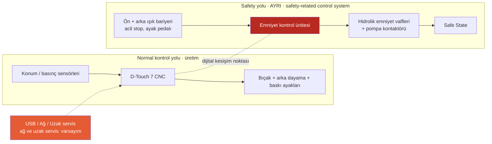

# Lab 1 · Safety Architecture

> **Çıktı:** Safety Function Map → Evidence Pack **EP 03 Safety Functions**

**Bağlam:** İnen kesme bıçağı ve hidrolik baskı ayakları (sac tutucular) el/parmak için ciddi tehlikedir; koruma **ön ışık bariyeri + arka ışık bariyeri + acil stop → emniyet kontrol ünitesi → hidrolik valf/pompa enerjisinin kesilmesi** zinciridir. D-Touch 7 CNC ünitesi kesim parametrelerini yönetir; USB'si vardır ve fabrika ağına/üretici servisine bağlı olduğu **varsayılmıştır** — sorular oraya gidecek.

## Mimari

## Görev — sırayla cevaplar

### 1. Bu makinede tehlike nedir? İnsan neyden zarar görür?

İnen kesme bıçağı (el/parmak kesilmesi, amputasyon), hidrolik baskı ayakları (parmak ezilmesi), arka dayama hareketi (arka bölgede sıkışma) ve kesilen sacın keskin kenarları. Operatör sacı bıçak hattına hizalarken eli tehlike bölgesine yaklaşır.

### 2. Safety function (emniyet fonksiyonu) hangisidir?

Bıçak/baskı ayağı bölgesine erişimde (ön veya arka ışık bariyeri kesilince, acil stop basılınca) bıçağın inişini ve hidrolik hareketi durdurmak, yeniden başlamayı engellemek: ışık bariyeri → emniyet kontrol ünitesi → hidrolik valf/pompa enerjisi kesilir → Safe State.

### 3. Safety-related control system nerede? Şemada işaretleyin.

Şemadaki kesikli çerçeve: ön/arka ışık bariyeri ve acil stop girişleri, emniyet kontrol ünitesi (emniyet rölesi veya Safety PLC) ve hidrolik emniyet valfleri/pompa kontaktörü çıkışı. D-Touch 7 CNC ve USB/ağ/uzak servis bu yolun dışındadır.

### 4. Normal PLC ile Safety PLC farkı nedir?

D-Touch 7 CNC verim ve doğruluk için çalışır (arka dayama, kesme açısı, bıçak boşluğu, strok). Emniyet ünitesi insanı korumak için tasarlanmıştır: çift kanallı, kendini sürekli test eden, arızada güvenli duruma geçen, parametreleri ayrı ve kilitli denetleyicidir.

### 5. PLr / SIL neden var? Bu fonksiyon için neden önemli?

Bıçak geri dönüşü olmayan ağır yaralanma (parmak kaybı) yaptığı ve operatör sık sık tehlike bölgesine yaklaştığı için risk yüksektir; bu yüzden ışık bariyeri zincirinin yüksek güvenilirlikte (giyotinlerde tipik olarak PLr d/e düzeyi beklenir) çalışması gerekir. Bu güvenilirlik doğrulanmış konfigürasyona ve doğru emniyet mesafesine bağlıdır.

### 6. Safe state (güvenli durum) nedir?

Bıçak ve baskı ayakları durmuş, hidrolik basınç tutulmuş/boşaltılmış, valfler enerjisiz; bıçak kendi ağırlığıyla inemez. Işık bariyeri kesikken makine kendiliğinden başlamaz; yalnızca bölge boşaltılıp bilinçli reset ile yeniden çalışır.

### 7. Safety function hangi dijital bağımlılıklara sahip?

Işık bariyeri sinyalleri ve kablolaması, emniyet ünitesinin yazılımı/parametreleri (muting, tepki süresi), hidrolik valf geri beslemesi, strok/konum sensörleri, D-Touch 7 CNC'nin emniyet ünitesiyle paylaştığı sinyaller ve firmware. Dijital kesişim noktası: USB ve ağ/uzak servis üzerinden CNC'ye erişim (varsayım).

### 8. Siber müdahale hangi noktadan bu fonksiyonu bozar?

USB veya ağ/uzak servis → D-Touch 7 CNC → strok, baskı ayağı veya arka dayama davranışını değiştirme; CNC'den emniyet ünitesine giden izin/muting sinyalini manipüle etme; emniyet parametrelerine yazma yetkisi varsa ışık bariyerini devre dışı bırakma. Ayrıca paylaşılan servis şifresi ve ekran üzerinden yetkisiz ayar.

