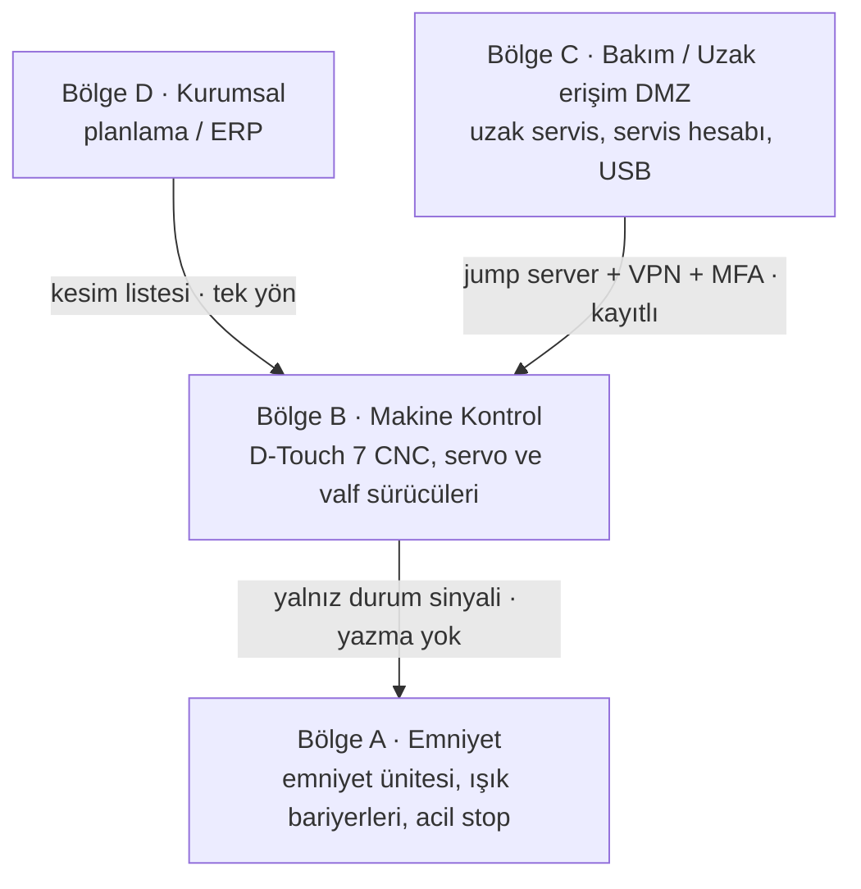

# Lab 2 · IEC 62443 Mini Workshop

> **Çıktı:** Zone / Conduit Diagram → Evidence Pack **EP 05 Zone & Conduit**

**Kavram:** Zone = benzer kritiklikteki cihazları bir bölgeye topla. Conduit = bölgeler arası her geçişe kontrollü bir kapı.

**Varlık listesi:** D-Touch 7 CNC kontrol ünitesi · **Emniyet kontrol ünitesi** (ön/arka ışık bariyeri, acil stop) · hidrolik ünite valf sürücüleri · CNC arka dayama servo sürücüsü · USB portu · fabrika ağı (Ethernet, varsayım) · **üretici uzak servis bağlantısı (varsayım)** · planlama/ERP PC'si (kesim listesi gönderir) · paylaşılan servis şifresi

## Zone / Conduit diyagramı

## Görev A — bölgeler

### 1. Hangi varlıklar aynı bölgede? Bölgeleri adlandırıp gruplandırın.

Bölge A – Emniyet: emniyet kontrol ünitesi, ışık bariyerleri, acil stop, hidrolik emniyet valfleri.
Bölge B – Makine Kontrol: D-Touch 7 CNC, arka dayama servo sürücüsü, hidrolik valf sürücüleri.
Bölge C – Bakım/Uzak erişim (DMZ): uzak servis bağlantısı, servis hesabı, USB (kontrollü kullanım).
Bölge D – Kurumsal: planlama/ERP PC'si, ofis ağı.

### 2. Uzak servis bağlantısı hangi bölgeye düşüyor — ve orada KALABİLİR Mİ? Neden?

Bugün doğrudan CNC'ye bağlıysa Bölge B'nin içinde kalıyor; bu hâliyle kalamaz. Dışarıdan makine kontrolüne kontrolsüz bir kapı olur. Bakım/DMZ bölgesine taşınmalı; yalnızca jump server + VPN + MFA ile, varsayılan kapalı açılmalı.

### 3. Bölgeler arası geçişler (conduit) nerede? Her geçişte ne kontrol edilecek?

DMZ↔Makine Kontrol (uzak servis); Kurumsal↔Makine Kontrol (yalnızca kesim listesi aktarımı, tek yön); Makine Kontrol↔Emniyet (yalnızca durum sinyali, emniyet parametresine yazma yok); USB↔CNC (yalnızca taranmış, yetkili medya). Her geçişte: kimlik/MFA, izinli protokol-port listesi, yön, kayıt.

## Görev B — uzak erişim kararı

| Karar | Seçenekler | Seçim + neden |
|---|---|---|
| **Aracı?** | Doğrudan / Jump server | Jump server – servis teknisyeni CNC'ye internetten doğrudan bağlanmaz; tek, izlenen kontrollü nokta. |
| **Tünel?** | Açık / VPN | VPN – şifreli ve yetkili kanal; açık bağlantı internetten taranır ve saldırıya uğrar. |
| **Kimlik?** | Parola / MFA | MFA – paylaşılan servis şifresi sızsa bile tek başına giriş sağlamaz. |
| **Hesap?** | Paylaşılan / Kişisel | Kişisel – kimin hangi kesim/emniyet parametresini değiştirdiği izlenebilir olur. |
| **Kayıt?** | Yok / Tam oturum kaydı | Tam oturum kaydı – olay incelemesi ve CRA bildirimi için kanıt. |
| **Zamanlama?** | Sürekli açık / Varsayılan kapalı | Varsayılan kapalı – yalnızca onaylı bakım penceresinde, vardiya sorumlusu onayıyla açılır. |
