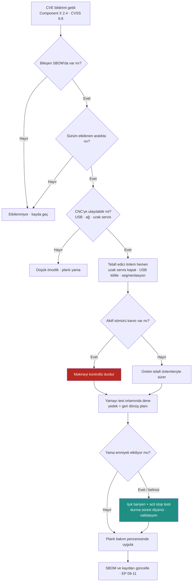

# Lab 5 · SBOM / CVE / Patch

> **Çıktı:** Vulnerability Decision → Evidence Pack **EP 09 · 10 · 11**

**Kavram:** **SBOM** = yazılım malzeme listesi · **CVE** = açığın kayıt numarası · **CVSS** = ciddiyet puanı (0–10).
Bir CVE sizi etkiler mi? Üç şart birlikte gerekir: bileşen **var**, sürüm **etkileniyor**, açık **ulaşılabilir**.

## Verilen zafiyet kaydı

| Alan | Değer |
|---|---|
| **Bileşen** | Durmazlar Component X (D-Touch 7 CNC yazılım kütüphanesi) |
| **Sürüm** | 2.4 |
| **CVE** | CVE-XXXX-XXXX |
| **Önem** | Critical (CVSS 9.8) |
| **Yama** | Mevcut |

*Component X ve CVE numarası föyde verilen eğitim amaçlı örnektir; gerçek bir açığı temsil etmez.*

## Karar akışı (Vulnerability Decision)

## Görev — karar akışı soruları

### 1. Bu CVE sizi gerçekten etkiliyor mu? (üç şartı kontrol edin)

Bileşen var mı: makinenin SBOM'unda Component X sürüm 2.4 kayıtlı → evet. Sürüm etkileniyor mu: üreticinin bildirimindeki etkilenen sürüm aralığında 2.4 var mı → doğrulanmalı. Ulaşılabilir mi: CNC'ye USB ve uzak servis üzerinden ulaşılıyor → evet. Üçü de evetse etkiler, öncelik yüksek.

### 2. Üretimi hemen durdurur musunuz? Neden / neden değil?

Hayır, körlemesine durdurmam: CVSS 9.8 tek başına karar değildir. Önce uzak servis bağlantısını kapatır, USB'yi kilitlerim (telafi), ışık bariyeri fonksiyonunu test ederim. Aktif sömürü kanıtı varsa makineyi kontrollü durdururum; yamayı planlı pencerede uygularım.

### 3. Yamayı doğrudan mı uygularsınız, önce test mi? Nerede test?

Önce test: üreticiden sürüm notlarını alır, mümkünse yedek kontrol ünitesinde veya üreticinin test ortamında denerim; CNC programlarının ve parametrelerin tam yedeğini ve geri dönüş planını hazırlarım; sonra planlı bakım penceresinde uygularım. Canlı makinede doğrudan uygulamam.

### 4. Bu yama bir safety validation etkiliyor mu? Nasıl anlarsınız?

Olabilir: CNC yazılımı strok, baskı ayağı ve durma zamanlamasını etkileyebilir. Anlamak için: üretici sürüm notları ve Component X'in emniyet sinyallerinde kullanılıp kullanılmadığı (etki analizi). Yama sonrası ışık bariyeri testi, acil stop testi ve durma süresi ölçümü (emniyet mesafesi hâlâ yeterli mi) yapılır, validasyon tekrarlanır.

### 5. Yama mümkün değilse compensating control (telafi edici önlem) ne olur?

Telafi: uzak servisi kapat veya jump server + VPN + MFA arkasına al, CNC'yi ayrı ağ segmentine ve güvenlik duvarı kuralı arkasına koy, paylaşılan şifreyi kaldır, USB'yi fiziksel olarak kilitle, ERP aktarımını tek yönlü yap, izleme/alarm kur; yama tarihini planla ve kabul edilen riski kayda geçir.

## Bu makine için akılda tutulacak nokta

Giyotin makasta yama sadece bir BT işi değildir. D-Touch 7 CNC strok, baskı ayağı ve durma zamanlamasını etkiler; durma süresi uzarsa ön ışık bariyerinin emniyet mesafesi (EN ISO 13855) artık yeterli olmayabilir. Bu yüzden **her CNC yamasından sonra durma süresi yeniden ölçülür** ve emniyet validasyonu tekrarlanır.
