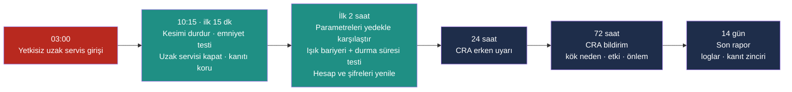

# Lab 6 · CRA Incident Simulation

> **Çıktı:** Incident Workflow → Evidence Pack **EP 13 Incident Response**

> 🚨 **Senaryo:** Saat **10:15**. Durmazlar VS makasın uzak servis hesabına gece 03:00'te tanınmayan bir konumdan girilmiş. CNC parametreleri değişmiş olabilir; **ışık bariyeri davranışı ve durma süresi henüz doğrulanmadı**. Makine kesim yapıyor. Vardiya sorumlusu sizsiniz.

**Kavram:** Bir olayda en değerli iki şey **zaman** ve **kanıt**tır. CRA'nın **24 saat / 72 saat / 14 gün** yükümlülükleri, iyi bir müdahale akışının doğal kilometre taşlarıdır — ezber değil.

## Olay zaman çizgisi (Incident Workflow)

## Kim ne yapar?

| Rol | Sorumluluk |
|---|---|
| Vardiya sorumlusu | Makineyi kontrollü durdurur, ekibi arar, saatleri kaydeder |
| İSG / emniyet sorumlusu | Işık bariyeri, acil stop ve durma süresi doğrulaması; emniyet onayı |
| Bakım-otomasyon mühendisi | CNC ve emniyet parametrelerini son onaylı yedekle karşılaştırır |
| BT / siber sorumlusu | Uzak servis hesabını kapatır, logları ve kanıtı korur, kök neden analizi |
| Üretim müdürü / sorumlu yönetici | Bildirim, Durmazlar ile koordinasyon, üretime dönüş kararı |

## Görev — zaman çizgisini doldurun

### 1. **10:15 — ilk 15 dk:** Kimi ararsınız? İlk üç eyleminiz?

Ararım: BT/siber sorumlusu, bakım-otomasyon mühendisi, İSG/emniyet sorumlusu, üretim müdürü. İlk üç eylem: 1) Kesimi kontrollü durdur, ışık bariyeri ve acil stop testini yap; emniyet doğrulanana kadar operatörü bıçaktan uzak tut. 2) Uzak servis bağlantısını ve servis hesabını kapat. 3) Kanıtı koru: saatleri not al, CNC ekran/log görüntüsü ve parametre yedeği al; reset yok.

### 2. **İlk 2 saat:** Emniyet güvende mi — nasıl doğrularsınız? Hangi kanıt korunur? Hangi hesap kapatılır?

Emniyet: CNC ve emniyet parametrelerini son onaylı yedekle karşılaştırır, ön/arka bariyer, acil stop ve durma süresi testini yaparım; doğrulanana kadar makine durur. Kanıt: uzak servis/VPN/güvenlik duvarı logları, CNC alarm/olay geçmişi, değişmiş parametrelerin kopyası. Kapatılacak: 03:00'te kullanılan servis hesabı ve paylaşılan şifre; tüm şifreler yenilenir.

### 3. **24 saat — CRA erken uyarı:** Hangi bilgi hazır olmalı?

Olayın tespit zamanı ve nasıl fark edildiği; ne olduğu (yetkisiz uzak servis erişimi, CNC parametresi değişmiş olabilir); etkilenen ürün/model/yazılım sürümü; kötü niyet şüphesi; alınan ilk önlemler; iletişim kişisi. (Not: CRA bildirimi üretici yükümlülüğüdür; kullanıcı olarak Durmazlar'a hemen bilgi veririz.)

### 4. **72 saat — CRA bildirim:** Kök neden, etki, önlem — kim ne yapıyor?

Kök neden (açık uzak servis/paylaşılan şifre): BT/siber ekibi + üretici. Etki (hangi parametre değişti, emniyet etkilendi mi): bakım-otomasyon mühendisi + İSG sorumlusu. Önlem (hesap, yama, segmentasyon, USB kilidi): BT + üretici servis. Bildirim ve koordinasyon: sorumlu yönetici.

### 5. **14 gün — son rapor:** Hangi loglar/kayıtlar korunmuş olmalı?

Uzak erişim/VPN/jump server oturum kayıtları, servis hesabı kimlik doğrulama logları, CNC alarm ve parametre değişiklik geçmişi, değişiklik öncesi/sonrası yedekler, güvenlik duvarı/ağ logları, emniyet testi ve durma süresi ölçüm tutanakları, eylem zaman çizelgesi ve kanıt zinciri. Loglar değiştirilemez, saatler senkron olmalı.

> ⚠️ **En sık hata:** "Resetleyip devam edelim" — o düğme, kanıtı sonsuza dek siler. Önce emniyet, hemen sonra kanıt.

## Bu makine için akılda tutulacak nokta

Giyotin makasta olay sonrası üretime dönüş kararı **bir emniyet kararıdır**, BT kararı değil. Parametreler yedekle birebir aynı çıksa bile ön ve arka ışık bariyeri testi ile durma süresi ölçümü yapılmadan makine yeniden kesime başlamaz. CRA'ya göre bildirim yükümlülüğü **üreticiye (Durmazlar)** aittir; kullanıcı işletme olarak görevimiz üreticiyi hemen bilgilendirmek ve kanıtı eksiksiz sunmaktır.
