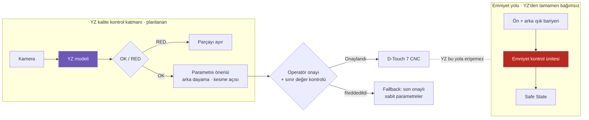

# Lab 7 · AI Safety Challenge

> **Çıktı:** AI Fail-Safe Decision → Evidence Pack **EP 03 + EP 15**

**Kavram — Prediction ≠ Safety:** Yapay zekâ bir karar üretir; güvenliği garanti eden mimari YZ'nin **dışında** tanımlanmalıdır.
Araçlar: **fail-safe · human override · monitoring · confidence threshold · fallback**

> 🤖 **Senaryo:** Durmazlar VS makasın çıkışına YZ'li kamera ile kesim kalitesi ve ölçü kontrolü **eklenmesi planlanıyor**; model, sapma görürse arka dayama ve kesme açısı düzeltmesi önerecek — proje aşaması değerlendirmesi.

## YZ karar zinciri ve emniyet sınırı

## Görev — üç başarısızlıkta güvenli davranış

### 1. **Model yanlış sınıflandırdı:** Kusurlu parçaya OK verdi. Sistem ne yapmalı? İkinci kontrol / insan onayı var mı?

Hatalı ölçülü/çapaklı sac OK geçerse: ikinci bağımsız kontrol (lazer ölçüm veya periyodik numune ölçümü) ve operatör onayı olmalı; parti sonunda yakalanırsa kesim durdurulur. YZ'nin önerdiği arka dayama/açı düzeltmeleri operatör onayı olmadan uygulanmaz ve sınır değerlerle kilitlidir. Işık bariyeri zinciri YZ'den tamamen bağımsızdır.

### 2. **Girdi manipüle edildi:** Kamera verisi bozuk/sahte. Nasıl fark edilir? Şüpheli girdide ne yapılır?

Kamera sağlık/canlılık kontrolü (donmuş kare, zaman damgası), kalibrasyon referans işareti, görüntü kalitesi ve anomali izleme ile fark edilir. Şüpheli girdide otomatik OK ve otomatik parametre düzeltmesi yok: parçayı RED/ayır, alarm ver, operatöre devret, logla (fail-safe).

### 3. **Confidence düştü:** Model "emin değilim" diyor. Eşik ne olmalı? Altında: dur / insana sor / fallback?

Eşik risk analizi ve deneme kesimleriyle belirlenir (ör. ≥ %95). Altında otomatik OK ve düzeltme yok: parçayı ayır, operatöre sor (human override). Düşük güven sürerse fallback: YZ devre dışı, manuel ölçüm ve son onaylı sabit parametrelerle kesime devam.

## Karar tablosu — AI Fail-Safe Decision

| Başarısızlık | Güvenli davranış (hangi kavramla?) |
|---|---|
| **Model yanlış sınıflandırdı** | İkinci bağımsız ölçüm + operatör onayı + hatalı OK oranı izleme; parametre önerisi onaysız uygulanmaz (fail-safe, human override, monitoring); emniyet YZ'den bağımsız. |
| **Girdi manipüle edildi** | Kamera sağlık ve referans kontrolü; şüpheli girdide RED/ayır, alarm, operatöre devret (monitoring, fail-safe). |
| **Confidence düştü** | Eşik altında otomatik OK/düzeltme yok, operatöre sor; sürerse YZ'siz manuel moda geç (confidence threshold, human override, fallback). |

## Bu makine için akılda tutulacak nokta

YZ bu makinede yalnızca **kalite** kararı verir (parça doğru kesildi mi?). İnsanı koruyan ışık bariyeri → emniyet ünitesi → hidrolik emniyet valfleri zinciri YZ'ye hiçbir şekilde bağlı değildir. YZ ne kadar yanılırsa yanılsın, en kötü sonuç hatalı bir parçadır; bir parmak değil. Mimarinin amacı tam olarak budur.
